# AI 模块 UML 图（类依赖 / 时序）

> 范围：`glucopilot-business/src/main/java/com/threadfit/glucopilot/ai` 包，115 个 Java 文件。
> 依赖来自**真实 import 与字段/构造参数**（用脚本扫出 268 条包内 import 边，再按代码核对），
> 只出现在 javadoc 里的类名**不算依赖**、没有画线（例如 `ChatRoundGuard` 的注释提到
> `ChatMessageService`、`AiModelCipher` 的注释提到 `AiRuntimeConfigService`，实际都不持有）。
>
> 渲染：GitHub / VS Code（Markdown Preview Mermaid Support）/ Typora 直接渲染；
> 也可把单张图的 `mermaid` 代码块粘到 <https://mermaid.live> 看。
> 一个页面塞不下 115 个类，所以按「装配 → 主链路 → 子系统」拆成 9 张图，最后附依赖矩阵。

## 目录

| 图 | 内容 | 看它解决什么问题 |
| --- | --- | --- |
| §1 | 分层包依赖 | 模块整体怎么分层、有没有反向依赖 |
| §2 | Spring 装配图 | 3 个 ChatClient / 2 个 ChatModel / advisor / 工具从哪来 |
| §3 | 对话主链路类图 | `ChatCompletionServiceImpl` 到底依赖谁 |
| §4 | Advisor 链顺序 | 一次请求穿过哪些 advisor、顺序为什么是这样 |
| §5 | 记忆与摘要类图 | 上下文怎么组装、摘要/抽取怎么异步跑 |
| §6 | 模型配置类图 | `Snapshot` / `AiModelSpec` / 快照刷新 |
| §7 | 场景路由类图 | `SceneCode` 如何路由到模型/参数/提示词 |
| §8 | 时序：一次流式补全 | 从 HTTP 到 SSE done 的完整调用顺序 |
| §9 | 时序：后台改模型热生效 | 为什么改完 60 秒内生效、为什么不用重启 |
| §10 | 依赖矩阵 + 反向索引 | 「我要改 X，应该动哪几个类」 |

---

## §1 分层包依赖

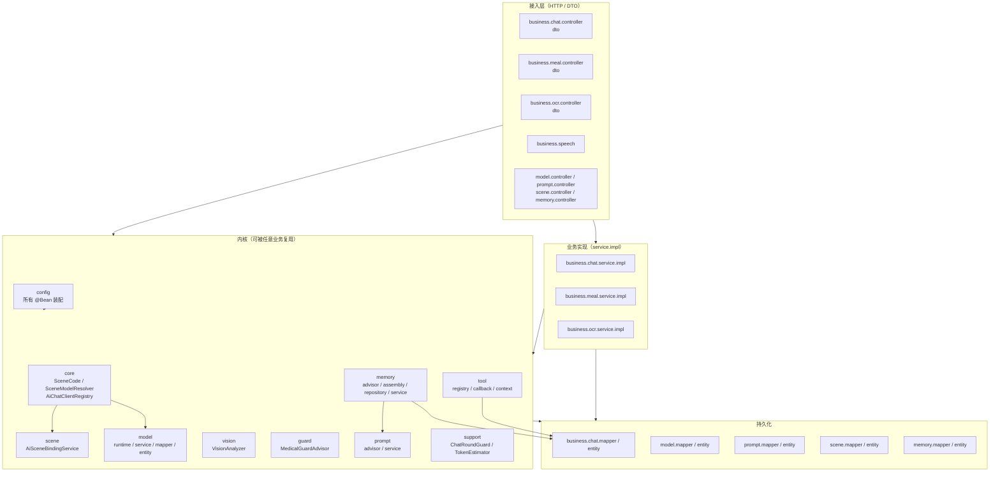

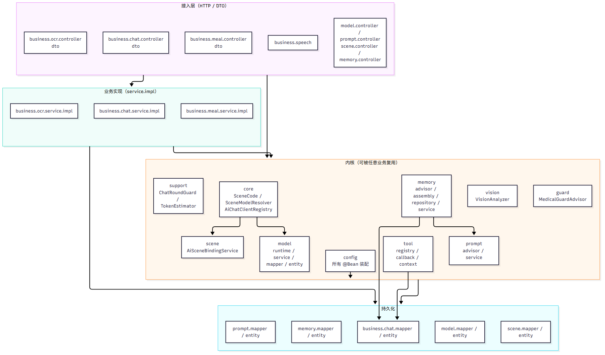

**唯一的「向上依赖」**：`k_memory` 与 `k_tool` 依赖 `business.chat` 的 `ChatMessageMapper` / `ChatSessionService` / `ChatToolCall`——因为记忆和工具调用记录本质是**对话的表**。这是有意接受的方向，不是泄漏（否则要把 `chat_message` 的读取复制一份）。

`k_config` 依赖 L2 全体（它就是装配层），所以图上 `config --> L2` 那条线最粗。

---

## §2 Spring 装配图

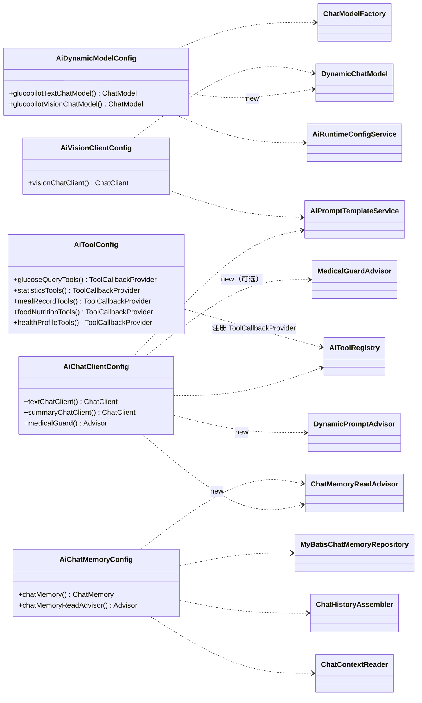

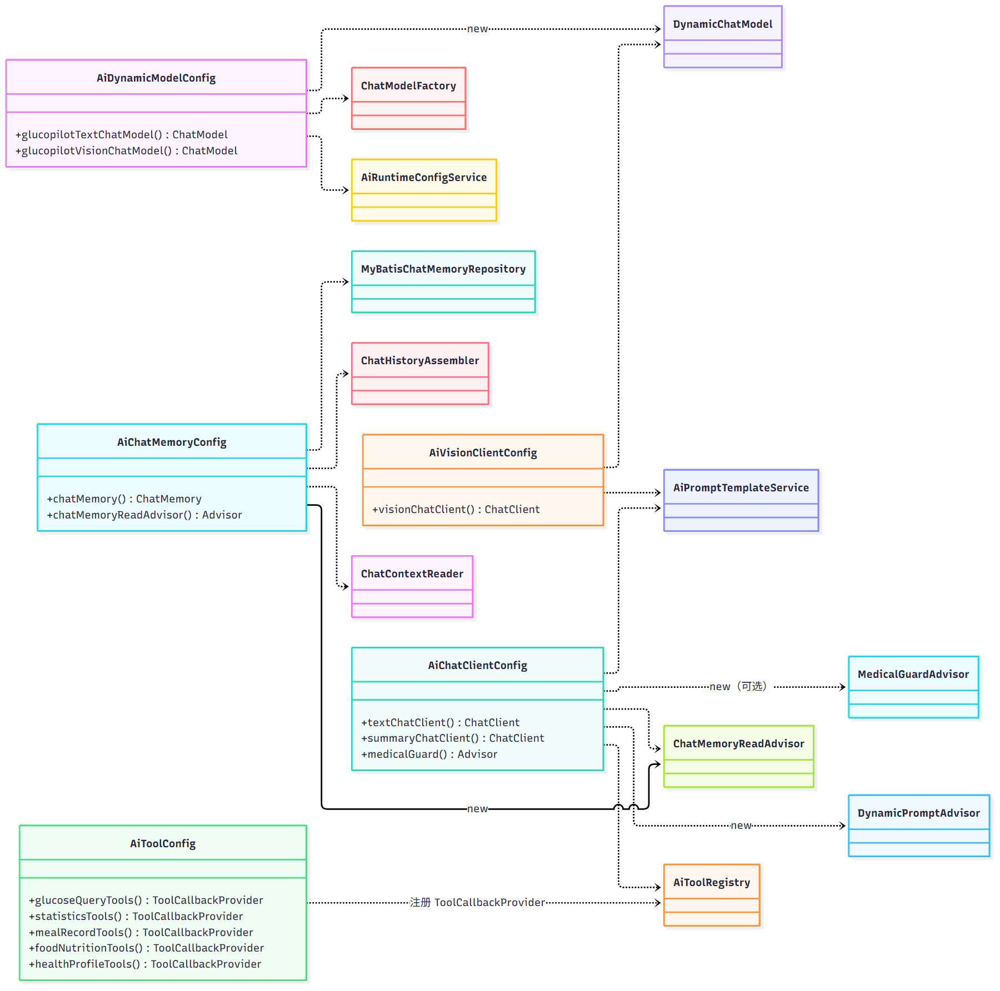

三个 ChatClient 的装配差异（这是全模块最容易被改错的地方）：

| Bean | 来源 | 工具 | Advisor | 为什么 |
| --- | --- | --- | --- | --- |
| `textChatClient` | **clone 框架注入的 `ChatClient.Builder`** | ✅ `defaultTools` | ✅ 医疗护栏 / 记忆 / 动态提示词 | 工具由自动装配 Builder 上的 `ToolCallingAdvisor` 执行，自己 `ChatClient.builder()` 会静默丢工具与观测 |
| `summaryChatClient` | `ChatClient.builder(glucopilotTextChatModel)` | ❌ | ❌ | 摘要/记忆抽取是内部任务，不该带人设、记忆、工具 |
| `visionChatClient` | `ChatClient.builder(glucopilotVisionChatModel)` | ❌ | ❌ | 视觉通道只做单轮识别，参数由 `ai.vision.*` 烤进模型 |

两个 ChatModel：`glucopilotTextChatModel` 是 `@Primary` 的 `DynamicChatModel`（委托），`glucopilotVisionChatModel` 非 Primary、`yamlFallback=null`。`@ConditionalOnMissingBean` 按**返回类型**判定，而 starter 返回的是 `DeepSeekChatModel`、委托声明的是 `ChatModel`，所以两者共存——`ChatClientAutoConfiguration` 的单值 `ChatModel` 参数因此固定拿到 `@Primary` 那个。

---

## §3 对话主链路类图

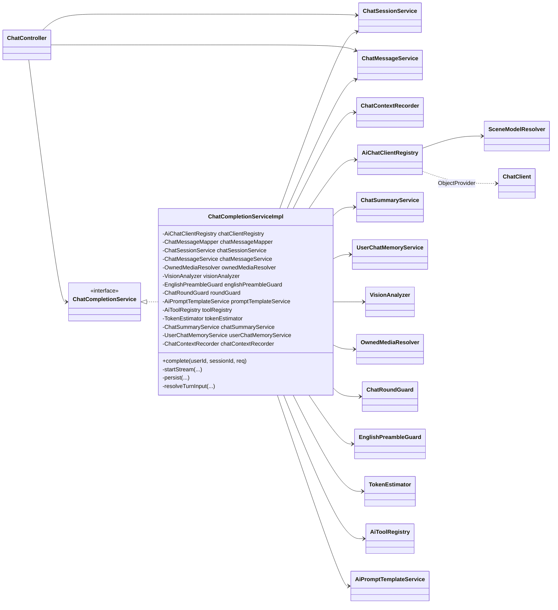

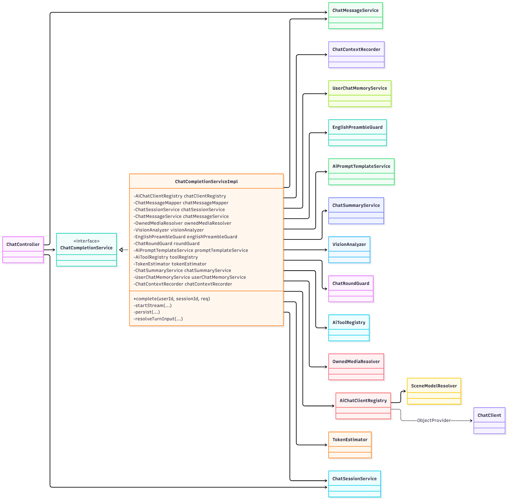

`ChatCompletionServiceImpl` 是**唯一的编排者**：16 个字段里 7 个是「读」依赖（mapper/session/message/media），5 个是「增强」依赖（vision/prompt/tool/summary/memory），3 个是「保护」依赖（roundGuard/englishPreambleGuard/estimator）。它不持有任何 `ChatModel`/`ChatClient` 的具体类型——一律经 `AiChatClientRegistry`。

---

## §4 Advisor 链顺序

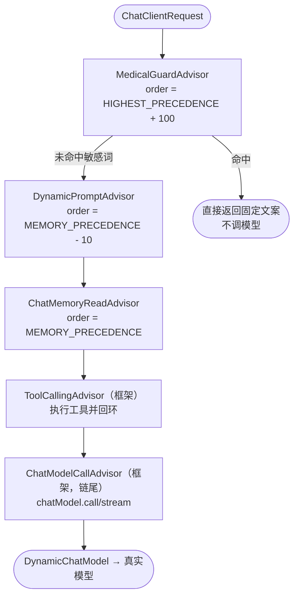

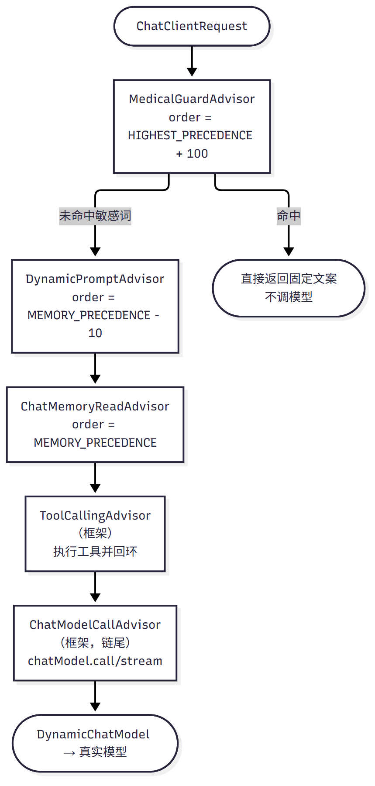

| Advisor | order | 职责 | 关键约束 |
| --- | --- | --- | --- |
| `MedicalGuardAdvisor` | `HIGHEST_PRECEDENCE + 100` | 只扫**最后一条 UserMessage** 的敏感词，命中直接返回固定文案 | 曾用 `getContents()` 扫全文，把系统提示词里的「开药/剂量」也扫进去导致全体误拦 |
| `DynamicPromptAdvisor` | `MEMORY_PRECEDENCE - 10` | **替换**所有 SystemMessage 为 `systemPrompt(scene)` | 必须排在记忆之前，否则组装时看到的还是旧系统提示 |
| `ChatMemoryReadAdvisor` | `MEMORY_PRECEDENCE` | 读历史/摘要/长期记忆/工具摘要 → `ChatHistoryAssembler` 组装 | 与框架记忆 advisor 同序，保证在链尾调用前 |
| `ToolCallingAdvisor` | 框架默认 | 执行 `ToolCallback`、把结果回喂 | 只挂在 `textChatClient` 上 |
| `ChatModelCallAdvisor` | 链尾 | 把请求交给 `ChatModel` | 由 `ChatClient` 内部 push |

顺序由 `getOrder()` 决定，**与注册顺序无关**；三个自定义 advisor 的常量写在各自类里。

---

## §5 记忆与摘要类图

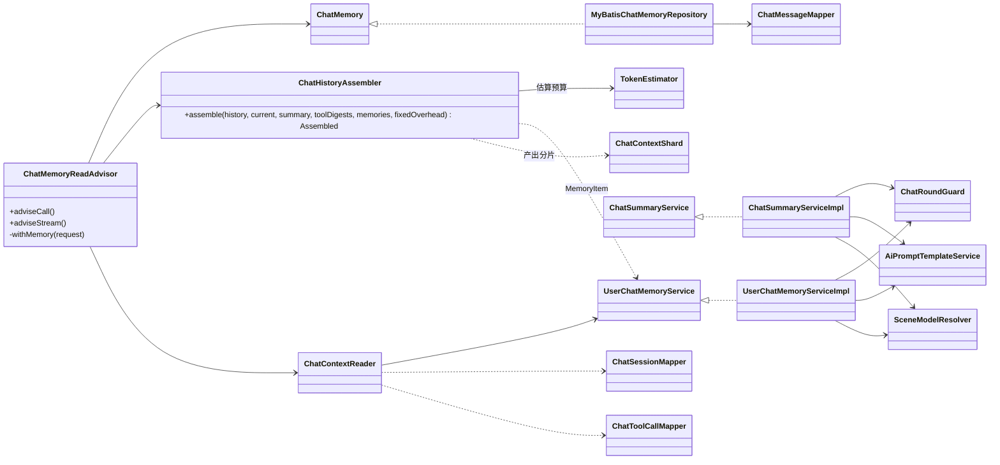

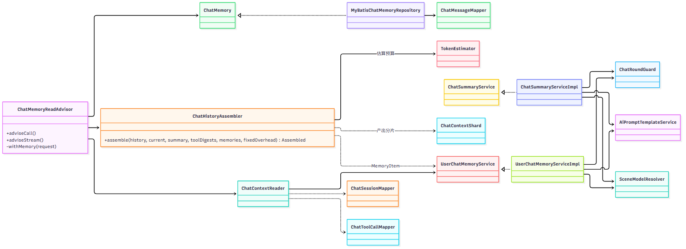

两个 `*ServiceImpl` 都：单飞（`ChatRoundGuard` 按 sessionId 加键）→ 由 `SceneModelResolver` 给参数 → 用 `summaryChatClient`（无 advisor）调模型 → 解析 → 写库。区别是摘要写 `chat_session.context_summary`，记忆写 `chat_user_memory`。

---

## §6 模型配置类图

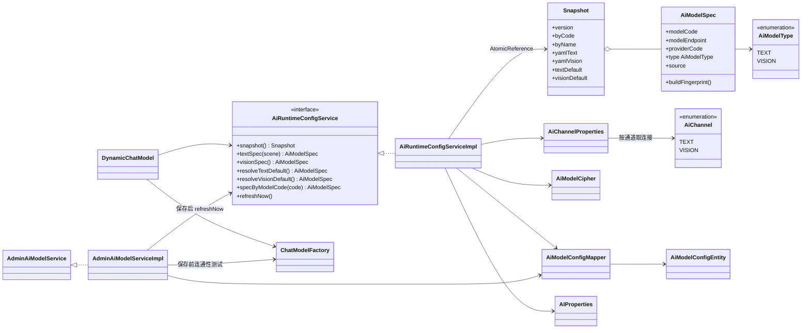

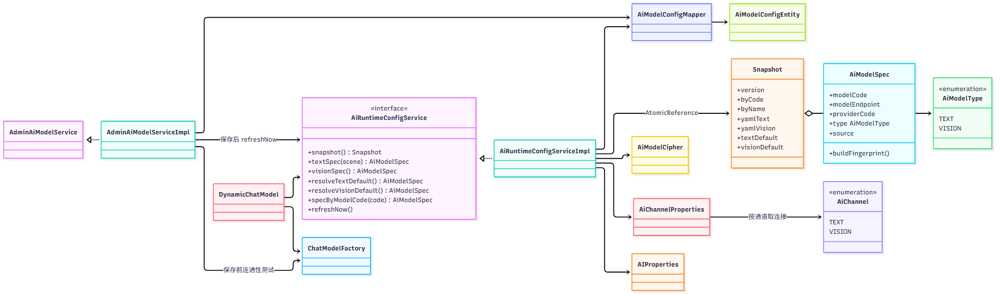

`Snapshot` 是**不可变快照 + 内容指纹**：`version` 变才重建 HTTP 客户端（`DynamicChatModel.pruneIfConfigChanged`）。`AiModelSpec` 是「一份模型的完整事实」，`type`（用途）与 `providerCode`（协议）正交。

---

## §7 场景路由类图

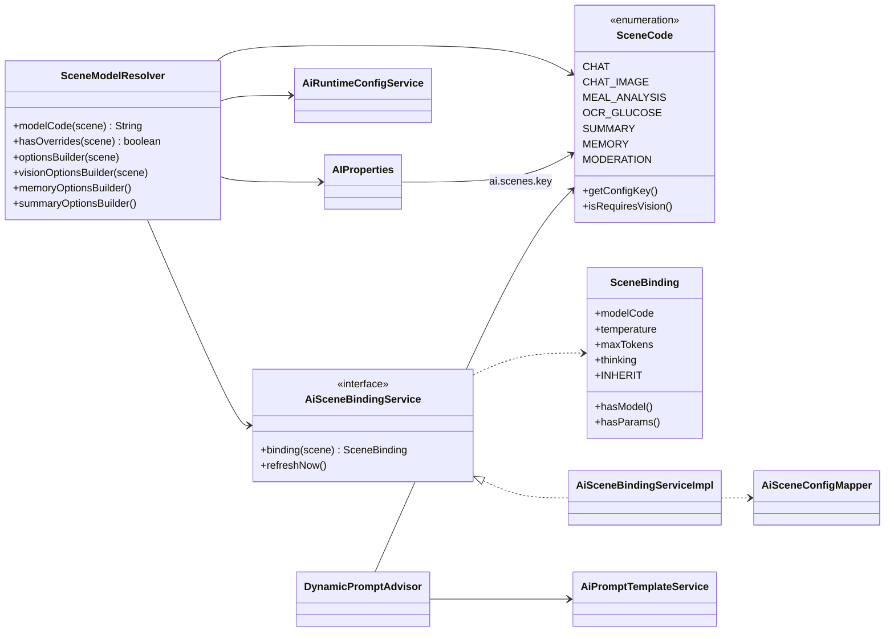

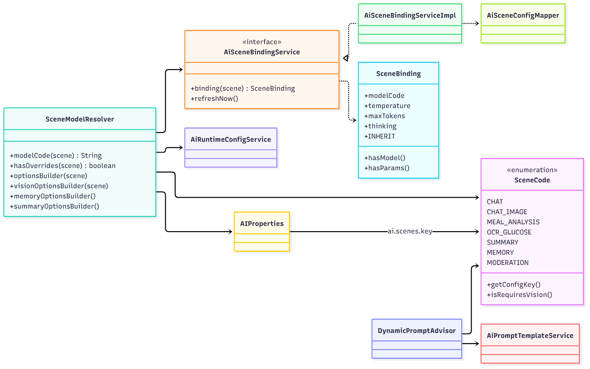

一个场景 → 三条独立解析链（详见 `docs/AI-模块实现说明.md` §7、`docs/AI-模块数据表说明.md` §14）：

| 解析链 | 入口 | 优先级 |
| --- | --- | --- |
| 模型 | `SceneModelResolver.modelCode()` | 场景绑定 → yaml `ai.scenes.*.model-code` → 通道默认（文本/视觉各一套） |
| 参数 | `SceneModelResolver.optionsBuilder()` / `visionOptionsBuilder()` | 绑定非空字段 → yaml `ai.scenes.*` → 模型自身 options |
| 提示词 | `AiPromptTemplateService.systemPrompt(scene)` | `ai_prompt_template` 启用版本 → classpath `prompts/<key>/system.md` |

---

## §8 时序：一次流式补全

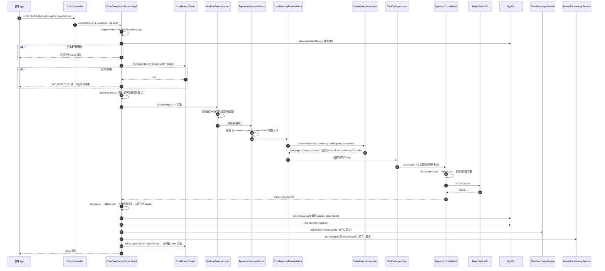

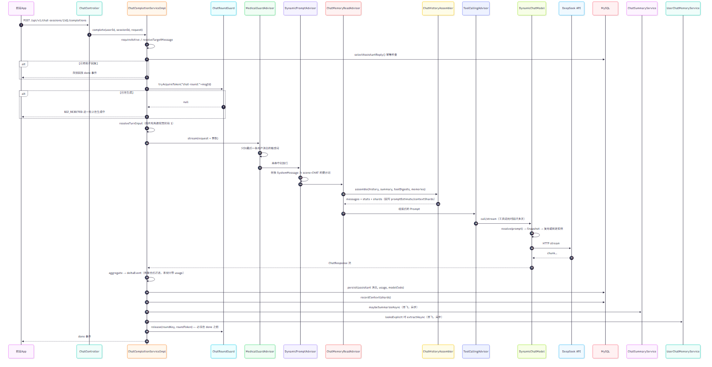

要点：`release` 在 `done` 之前执行（Reactor 的 `doFinally` 是「先向下游传播 onComplete、再跑回调」，只靠它会让客户端收到 done 后立刻重发被误判「正在生成中」，这正是 2026-10-19 CI 单点失败的原因）；`doFinally` 只作兜底，且用**带令牌**的 `remove(key, token)` 防止误删下一轮刚拿到的锁。

---

## §9 时序：后台改模型热生效

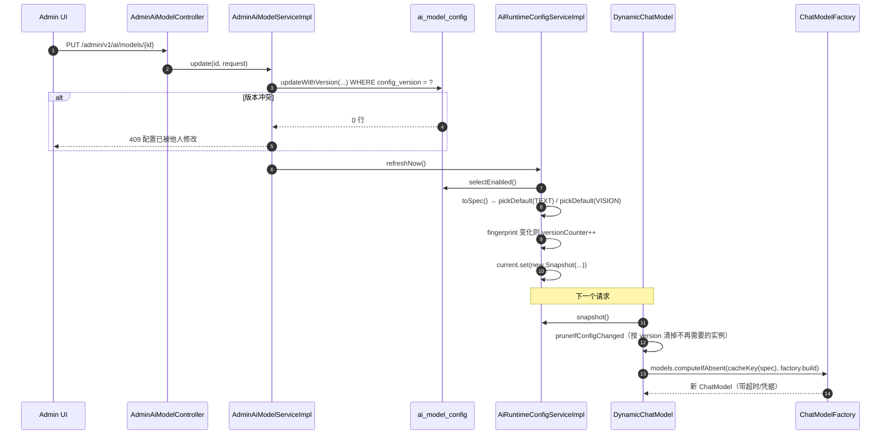

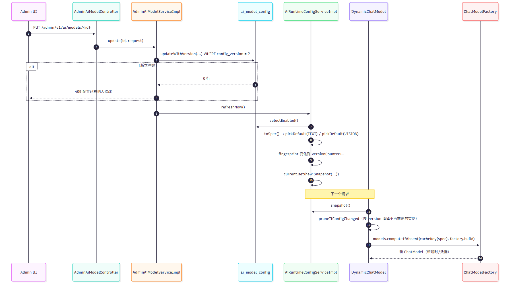

没有 `refreshNow()` 时靠 60 秒 TTL 兜底；**跨实例**目前是「最多滞后 60 秒」，pub/sub 扩展点在批次 4 才做。

---

## §10 依赖矩阵

只列「有实质协作」的边（构造注入或运行期调用），`→` 表示「持有/调用」。DTO、Entity、Mapper 的标准三层关系不重复列。

| 类 | 依赖 | 用途 |
| --- | --- | --- |
| `ChatController` | `ChatSessionService` `ChatMessageService` `ChatCompletionService` | 5 个会话接口 + SSE |
| `ChatCompletionServiceImpl` | `AiChatClientRegistry` | 取 text/vision client 与 options |
| 〃 | `ChatSessionService` `ChatMessageService` `ChatMessageMapper` | 会话校验、消息落库、幂等查回复 |
| 〃 | `VisionAnalyzer` `OwnedMediaResolver` | 图片轮两阶段、媒体归属校验 |
| 〃 | `ChatRoundGuard` `EnglishPreambleGuard` `TokenEstimator` | 单飞、英文前言剥离、token 估算 |
| 〃 | `ChatSummaryService` `UserChatMemoryService` | done 之后的异步副作用 |
| 〃 | `ChatContextRecorder` | 上下文分片落库 |
| `AiChatClientRegistry` | `SceneModelResolver` | 模型编码 / 参数 / 是否有覆盖 |
| `SceneModelResolver` | `AiRuntimeConfigService` `AiSceneBindingService` `AIProperties` | 三层优先级解析 |
| `DynamicChatModel` | `AiRuntimeConfigService` `ChatModelFactory` | 请求期解析 + 实例缓存 |
| `ChatModelFactory` | `AiHttpTimeouts` | DeepSeek 的 RestClient 超时 |
| `AiRuntimeConfigServiceImpl` | `AiModelConfigMapper` `AiModelCipher` `AiChannelProperties` `AIProperties` | 快照加载、解密、通道凭据 |
| `AiPromptTemplateServiceImpl` | `AiPromptTemplateMapper` `AIProperties` | DB/classpath 双源提示词 |
| `DynamicPromptAdvisor` | `AiPromptTemplateService` | 每请求替换系统提示词 |
| `ChatMemoryReadAdvisor` | `ChatMemory` `ChatHistoryAssembler` `ChatContextReader` | 组装上下文 |
| `ChatHistoryAssembler` | `AIProperties` `TokenEstimator` `UserChatMemoryService.MemoryItem` | 预算裁剪 + 分片 |
| `MyBatisChatMemoryRepository` | `ChatMessageMapper` `ChatSessionService` | 历史读写（含图片摘要回放） |
| `ChatSummaryServiceImpl` | `ChatMessageMapper` `ChatSessionMapper` `AiPromptTemplateService` `SceneModelResolver` `ChatRoundGuard` | 摘要 |
| `UserChatMemoryServiceImpl` | `ChatMessageMapper` `ChatUserMemoryMapper` `AiPromptTemplateService` `SceneModelResolver` `ChatRoundGuard` | 记忆抽取/注入 |
| `AiToolRegistry` | `AIProperties` `ToolCallbackProvider` `TracingToolCallback` | 白名单注册 + 追踪包装 |
| `TracingToolCallback` | `ToolCallTraceRecorder` `AiToolContext` | 每次调用记账 |
| `ToolCallTraceRecorder` | `ChatToolCallMapper` `AIProperties` | 落 `chat_tool_call`（只存摘要） |
| `VisionAnalyzer` | `AiChatClientRegistry` `AiPromptTemplateService` `AIProperties` | 看图描述 / 结构化识别 |
| `MedicalGuardAdvisor` | `AIProperties.GuardProperties` | 敏感词硬拦截 |
| `AdminAiModelServiceImpl` | `AiModelConfigMapper` `AiModelCipher` `AiRuntimeConfigService` `ChatModelFactory` | 后台 CRUD + 测试 |
| `AdminAiPromptServiceImpl` | `AiPromptTemplateMapper` `AiPromptTemplateService` `AIProperties` `SceneCode` | 提示词 CRUD、启用互斥、`refreshNow()` |
| `AdminAiSceneServiceImpl` | `AiSceneConfigMapper` `AiRuntimeConfigService` | 场景绑定 CRUD + 校验 |

### 反向索引：改哪儿

| 我要… | 动这些类 |
| --- | --- |
| 加一个场景 | `SceneCode`（枚举）→ `application.yaml` 的 `ai.scenes.<key>` → `prompts/<key>/system.md` → 业务调用点 → 三处数量断言测试 |
| 换场景的模型/参数 | 无需改码：`ai_scene_config`（后台）；要改默认值才动 `AIProperties` / `AiChannelProperties` |
| 加一个工具 | `tool/*Tools.java` + `AiToolConfig` 注册 + `ai.tools.allow-list` 加方法名 |
| 改记忆策略 | `AIProperties.MemoryProperties` + `ChatHistoryAssembler` + `ChatMemoryReadAdvisor` |
| 改模型解析优先级 | `SceneModelResolver`（一个类） |
| 改快照刷新 | `AiRuntimeConfigServiceImpl.load()` + `DynamicChatModel.pruneIfConfigChanged` |
| 改提示词来源 | `AiPromptTemplateServiceImpl.resolve()` |
| 改审核 | `community/CommunityModerationWorker`（AI 侧）+ `CommunityModerationQueue`（状态机） |


---

## 附：图片怎么重新生成

本目录的 `uml/*.png` 由 mermaid-cli 从本文档的 mermaid 代码块渲染（含文字与布局），
改完图源后重跑即可（本机有 Edge/Chrome 就不需要下载 Chromium）：

```powershell
# 一次装好（临时目录即可）
npm install @mermaid-js/mermaid-cli
# 渲染本文档全部图，产物输出到 docs/uml/
npx mmdc -i docs/AI-模块UML.md -o docs/uml/index.md -e png -a docs/uml -p puppeteer.json --size 1800 -b white
```

`puppeteer.json` 指定浏览器路径，例如：

```json
{ "executablePath": "C:\\Program Files (x86)\\Microsoft\\Edge\\Application\\msedge.exe", "args": ["--no-sandbox"] }
```

两个坑：`puppeteer.json` 必须是 **UTF-8 无 BOM**（否则 mermaid-cli 报
`SyntaxError: Unexpected token ''`）；产物是 `index-1.png … index-9.png`，按 §1–§9 顺序对应本文各图，
重命名成 `01-packages.png … 09-seq-refresh.png` 即可（本文的图片引用用的是后者）。