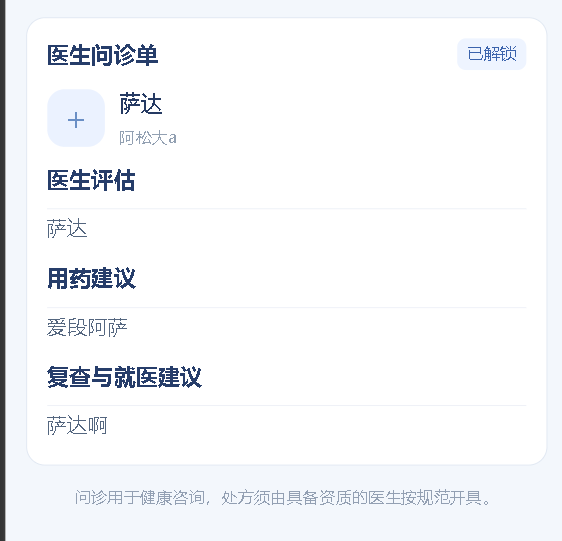

# 支付宝沙箱充值联调

当前流程为：创建充值订单和金额 → 当面付二维码 → 沙箱买家付款 → 验签通知/后端主动查单 → 沙箱余额与唯一流水；患者再用钱包余额支付100分查看问诊单，医生获得问诊收入。V78把医生提现从本地模拟升级为支付宝沙箱转账，仍需管理员审核并到第5个工作日出款；不会使用正式支付宝网关或真实资金。

本机目前没有公网HTTPS回调地址，保留`POST /api/v1/payments/alipay/sandbox/notify`，实际付款继续以后端主动查单结果确认；不能把localhost配置成支付宝可访问的回调地址。未来部署公网后在环境配置中填写`ALIPAY_SANDBOX_NOTIFY_URL`并重启，SDK预下单会携带该地址。回调先RSA2验签，再核对应用/商家/订单/金额/交易号和成功状态，只有`TRADE_SUCCESS`或`TRADE_FINISHED`才入账；重复通知和查单不会重复加钱。

## 网页账号付款

钱包充值统一创建网页付款订单，二维码选项和二维码展示已移除。选择金额并创建新订单后，点击“前往支付宝沙箱付款”，小程序进入独立收银台页面，通过web-view尝试打开支付宝沙箱网页；返回付款页后自动查单，也可点击“我已付款，查询结果”。账号和支付密码在支付宝页面输入，收银台的具体布局由支付宝提供。

微信web-view的目标页和重定向可能受到业务域名校验限制，本次按钮及加载失败返回/重试流程已实现，真机是否能打开支付宝页面尚需实际验证。开发者工具展示不能替代真机验证。页面仅传订单号，按当前身份重新获取本人订单的官方链接；不会把登录Token或整条签名URL放进页面路由。

小程序收银台显示时每2秒串行主动查单，同一订单后端至少间隔1秒查询支付宝。确认订单PAID后卸载网页、提示付款成功并自动返回原付款页，无需再点确认；返回失败时仍可使用“返回付款页”按钮。网页加载也会触发查单，返回后原付款页再次读取状态。只有后端确认支付成功才返回，支付网页消息不能修改钱包余额。

后端使用官方 SDK 的 `alipay.trade.page.pay`，产品码为 `FAST_INSTANT_TRADE_PAY`，通过 `pageExecute(request, "GET")` 返回签名链接。链接绑定服务端订单号、金额和绝对到期时间。网页订单与扫码订单分别保存付款方式，历史订单默认扫码；更换方式须创建新订单。打开链接与生成链接均不会触发余额入账，仍以验签通知或主动查单确认。项目页面不收集支付宝密码。[支付宝官方 SDK 实现](https://github.com/alipay/alipay-sdk-java-all/blob/master/v2/src/main/java/com/alipay/api/AbstractAlipayClient.java)

重建并重启后端执行 V80，再重新编译小程序即可加载。本机已完成升级，实际生成的链接已在浏览器打开沙箱收银台，展示账号名和支付密码表单。买家已实际完成两笔网页充值，订单、唯一流水与钱包余额核对一致，网页付款及查单入账流程通过；之前扫码发生的 ALI23 仍未确认根因。

## 一、去哪里获取配置

登录[支付宝开放平台沙箱应用](https://open.alipay.com/develop/sandbox/app)。页面需要登录，菜单以当前控制台为准。

1. **沙箱应用**：复制沙箱AppID。注意不是微信小程序AppID，也不是正式支付宝应用ID。
2. **接口加签方式 / RSA2密钥**：本项目使用普通“公钥模式”，不是公钥证书模式。若页面没有可用的应用私钥，使用[支付宝开放平台开发助手](https://opendocs.alipay.com/common/02kipk)生成一对密钥，选择 **RSA2、2048位、PKCS8（Java适用）**。将生成的“应用公钥”配置到当前沙箱应用；“应用私钥”仅留在本机，填写 `ALIPAY_SANDBOX_PRIVATE_KEY`。不能用应用公钥代替私钥，也不能从公钥还原私钥。已有密钥时先找本机原私钥，不要只换私钥而不匹配平台公钥。
3. **支付宝公钥**：从同一沙箱应用的加签配置获取。它与“应用公钥”不同，后端用它验证支付宝响应和通知。
4. **沙箱账号**：商家账号显示的 **PID就是这里需要的商家UID（seller_id）**，通常以2088开头，填写 `ALIPAY_SANDBOX_SELLER_ID`；务必使用该沙箱应用对应的商家PID，不填买家PID或正式账号PID。付款使用买家测试账号，不能用商家自己付给自己。按控制台指引安装沙箱钱包。

不要将私钥、账号密码或完整支付报文发到聊天/提交GitHub。[官方Java SDK说明](https://github.com/alipay/alipay-sdk-java-all/tree/master/v2)包含公钥模式和RSA2配置说明。

## 二、填写本机环境变量

在自己未提交的 `.env` 填写下面变量。IDEA运行时须确认该 `.env` 已被当前项目的启动配置加载；也可以在“运行配置 → 环境变量”填写。无需修改业务代码。

```dotenv
ALIPAY_SANDBOX_ENABLED=true
ALIPAY_SANDBOX_APP_ID=你的沙箱AppID
ALIPAY_SANDBOX_PRIVATE_KEY=你的应用私钥_PKCS8
ALIPAY_SANDBOX_PUBLIC_KEY=支付宝公钥_不是应用公钥
ALIPAY_SANDBOX_SELLER_ID=沙箱商家UID
# 本地无公网地址时留空，使用主动查单确认；公网回调建议配置HTTPS。
ALIPAY_SANDBOX_NOTIFY_URL=
```

密钥可用去掉头尾和换行的Base64字符串。配置映射在 `glucopilot-business/src/main/resources/application.yaml` 的 `payments.alipay.sandbox`。

IDEA 运行配置中直接填写的环境变量也要核对。在“运行 → 编辑配置 → RuoYiApplication → 环境变量”查看 `ALIPAY_SANDBOX_PUBLIC_KEY`。如果这里仍保存旧值，需要在这里更新，并重新启动该运行配置。

网关在代码中固定为沙箱 `https://openapi-sandbox.dl.alipaydev.com/gateway.do`，本模块不能切换到生产网关。缺配置时钱包仍可查看和开通，但不创建支付订单。

## 三、回调和本地测试

- 回调路径：`POST /api/v1/payments/alipay/sandbox/notify`。可选配置格式为 `https://pay.example.com/api/v1/payments/alipay/sandbox/notify`；Nginx须转发POST表单、不重定向，不要求用户Token。
- 不要把内网地址或localhost作为支付宝公网回调地址。没有公网回调也可在付款页点击“我已付款，查询结果”，由后端调用支付宝查询接口确认。
- 只有这个第三方回调按支付宝协议返回纯文本 `success` / `failure`，其他接口保持统一JSON响应。
- [微信小程序原生支付接口](https://pay.wechatpay.cn/doc/v3/merchant/4012791898)用于微信支付。这里不调用 `wx.requestPayment` 唤起支付宝，而是展示沙箱二维码；可在电脑开发者工具展示，用手机沙箱钱包和买家账号扫码。

## 四、验收步骤

1. 重启后端，让Flyway执行V66，重新编译小程序。进入“我的→钱包管理→开通钱包”。
2. 确认页面显示“沙箱测试余额”，选择充值金额（1～1000元）。首次联调建议1元。
3. 确认后生成订单、展示二维码。用沙箱买家账号扫码付款；不要使用真实资金。
4. 付款页前台每5秒请求一次后端查单，最多3分钟后暂停；手动查询仍可用。后端同订单查单最多5秒一次，离开页面停止前端轮询。
5. 只有后端验签且金额/AppID/商家/交易号匹配后才显示已支付并到账。重复通知和查询不重复加余额；“我已付款”按钮本身不能使订单已支付。
6. 回到钱包核对余额，再在“我的订单→充值订单”核对状态。订单创建失败重试沿用请求编号，付款码加载失败可从待支付订单继续。

数据库：`wallet_recharge_order`保存订单与二维码，`wallet_sandbox_account`保存测试余额，`wallet_sandbox_ledger`保存每笔唯一入账。余额与订单、流水在同一事务中更新。未来真实资金须另外接入，不能把沙箱余额直接转为真实余额。

目前尚未接入真实资金交易、真实退款和正式支付宝提现。问诊单授权及医生沙箱收入已接入，充值不会增加可提现收入额度。申请先冻结、拒绝解冻，审核后第5个工作日通过支付宝沙箱出款；只有查单确认成功才清除冻结并显示到账。历史本地模拟记录仍标为模拟，不等同于支付宝沙箱到账。未实际完成沙箱付款或转账及后端确认前，不能声称到账已验证。

## 五、预下单失败排查

- `KEY_PAIR_CHECK` 表示配置中的公钥与应用私钥属于同一对密钥，需重新核对 `ALIPAY_SANDBOX_PUBLIC_KEY`。应填同一沙箱应用页面提供的支付宝公钥。运行配置中保存的旧值也可能导致这个问题。
- SDK 的 `CHECK_ALIPAY_PUBLIC_KEY_ERROR` 也表示误填应用公钥。SDK 会用应用私钥签名测试文字，再用配置的支付宝公钥验证，验证通过便触发该错误。本地检查会提前比较 RSA 模数并明确提示对应变量。

- 新增密钥格式检查：应用私钥须为RSA2、至少2048位、PKCS8；支付宝公钥须为有效RSA2公钥。支持PEM头尾、换行及配置中的字面量`\n`。
- 业务拒绝会显示支付宝安全错误码，例如`ACQ.SELLER_NOT_EXIST`，不输出原始报文或密钥；响应data仅含stage、providerCode、providerSubCode。可把这些错误码发来排查，不用提供私钥。
- 网络错误会区分`SDK_TIMEOUT`、`SDK_NETWORK`、`SDK_TLS_ERROR`，响应验签失败为`SDK_RESPONSE_SIGNATURE`。TLS错误先核对电脑时间、证书和网络代理，不关闭证书验证。
- 创建待支付订单不等于扣款，付款码生成失败时余额不会变化，可从“我的订单→充值订单”重试。

## 六、扫码提示 ALI23 时如何定位

`ALI23` 是手机沙箱客户端提示，不能仅凭该提示判定密钥错误、二维码过期或支付宝服务故障。先核对同一沙箱应用的 AppID、商家 PID 和买家测试账号，再根据同一订单的后端查单结果判断。

后端输出 `Alipay sandbox stage=... orderNo=... code=... subCode=... tradeStatus=...`。为避免泄露签名和完整报文，已关闭 SDK 原始报文日志；只记录订单编号、白名单错误码和交易状态，不记录二维码内容、买家身份或密钥。

| 查单结果 | 含义与处理 |
| --- | --- |
| `ACQ.TRADE_NOT_EXIST` | 这次查单未找到交易，保持待支付，不入账，不直接认定二维码失效。 |
| `code=10000`、`WAIT_BUYER_PAY` | 查询成功，交易仍等待付款；不增加余额。 |
| `code=10000`、`TRADE_SUCCESS` / `TRADE_FINISHED` | 进入订单、商家、金额等校验，通过后才入账。 |
| `code=10000`、`TRADE_CLOSED` | 按已关闭处理，不入账。 |

预下单 `10000` 只代表已取得付款码；查单 `10000` 只代表查询成功，都不等于支付成功。当前本地 `provider_trade_no` 在成功入账时才保存，因此本地没有交易号也不能证明支付宝侧不存在待付款交易。

如果配置一致、二维码内容无误，手机仍提示 ALI23，可在[支付宝开放平台支持中心](https://open.alipay.com/support/supportCenter.htm)结合扫码时间、商户订单号、应用和商家信息排查；不要提交私钥或完整签名报文。客户端版本号本身不足以认定版本不兼容。

## 七、医生提现接入支付宝沙箱转账（V78）

1. 复用本机已有沙箱AppID、应用私钥、支付宝公钥和商家PID，网关仍固定沙箱。沙箱应用需具备转账产品能力，付款商家有可用测试资金；否则按平台错误码处理，不能伪造成功。无需发送密钥。
2. 医生提现页面优先自动带入本人当前应用/商家下上次使用的收款账号；没有历史账号时，通过SDK查本人最近已入账充值并核对成功交易，识别付款买家UID。页面显示掩码和来源，可点击“更换”手动填写；没有可识别账号时仍需填写一次沙箱买家UID，不能填手机号、密码或商家PID。新申请固化本人确认的金额、收款UID和商家快照，识别账号本身不创建提现或改变余额。旧的待审核/待发放申请可由本人点击“补充沙箱收款账号”；开始出款后禁止修改收款方。
3. 审核流程和5个工作日保持不变；未到日期不能发放。到期任务或管理端“沙箱转账”使用原提现号作为out_biz_no，先查单，不存在才提交同号转账，再查单核对金额及收款方。接口为alipay.fund.trans.uni.transfer与alipay.fund.trans.common.query，产品TRANS_ACCOUNT_NO_PWD、场景DIRECT_TRANSFER。参考[官方SDK转账参数](https://raw.githubusercontent.com/alipay/alipay-sdk-java-all/master/v2/src/main/java/com/alipay/api/domain/AlipayFundTransUniTransferModel.java)和[查询响应字段](https://raw.githubusercontent.com/alipay/alipay-sdk-java-all/master/v2/src/main/java/com/alipay/api/response/AlipayFundTransCommonQueryResponse.java)。
4. 转账场景名称和报备类型取当前商家配置。可在本机环境设置ALIPAY_SANDBOX_TRANSFER_SCENE_NAME与ALIPAY_SANDBOX_TRANSFER_SCENE_INFO_TYPE；代码默认“业务结算”与“结算款项名称”。如平台拒绝场景信息，按当前沙箱控制台和[官方字段说明](https://opendocs.alipay.com/open/0iaxid)核对，不修改签名或网关来绕过。
5. 小程序点击“刷新状态”或下拉刷新，会先查询本人已开始的转账，再读取最新提现记录、可提现额及冻结额；不会新建转账或提前发放。医生后台也支持刷新；管理员可按单查询结果。
6. 查询SUCCESS且单号、金额、收款方（返回时）、商家快照正确后，在同一事务内清冻结、标完成和记唯一PAYOUT流水。查询明确FAIL/CLOSED退回冻结收入；网络超时、验签错误或对账不一致保持冻结并显示待核实，下次仍用原编号查单。外部网络期间不持有数据库事务。
7. 本机没有公网HTTPS回调时仍可通过主动查单确认转账。审批通过不等于到账；“已到账沙箱钱包”仍仅指支付宝测试资金，不能兑换为真实余额。

升级需重建重启后端执行V78，并重新编译小程序、刷新管理端。迁移保留旧单状态和冻结款，历史已完成SIM流水仍明确显示“已模拟发放”。
